# Sentin8:Acme - Detailed Design Document

## 1. Scope & Context

Sentin8:Acme owns the platform's post-quantum certificate authority:

- **Owns**: the Root/Intermediate CA hierarchy (on-disk, `$SENTIN8_ACME_DATA_DIR`),
  all ACME (RFC 8555) protocol state (accounts, orders, authorizations,
  challenges), issued leaf certificates + their metadata, the mTLS client-cert
  issuance endpoint (`POST /v1/client-cert`), the public CA download endpoints,
  and the certificate revocation metadata.
- **Does NOT own**: tenant identity (Sentin8:Auth verifies bearers), the
  DCR thumbprint binding (workloads register their cert thumbprints with
  Sentin8:Auth directly), the inbound-issuer role for upstream ACME
  (proxy-only against the configured upstream directory), CRL/OCSP
  distribution (not implemented), and Bus's internal durability (event
  delivery rides the local-outbox + produce-API path - acme's only table
  is its own `acme.outbox`). The :80 HTTP-01 ingress is owned by
  Sentin8:Proxy (which forwards challenge requests to acme).

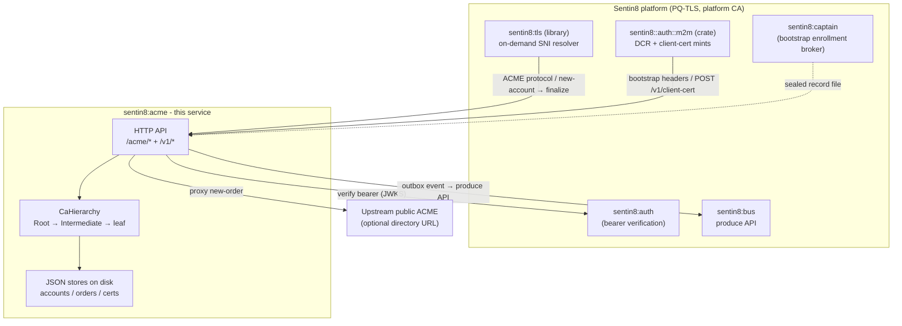

Trust boundary: everything inside the ACME subgraph shares the process
security context (CA private keys, 0600). Callers reach acme only over
PQ-TLS terminated in-process by `sentin8-tls`; the CA private-key directory
is deliberately never exposed to other services' environments
(`SENTIN8_ACME_DATA_DIR` is not in the captain's env propagation list).

## 2. Runtime Architecture

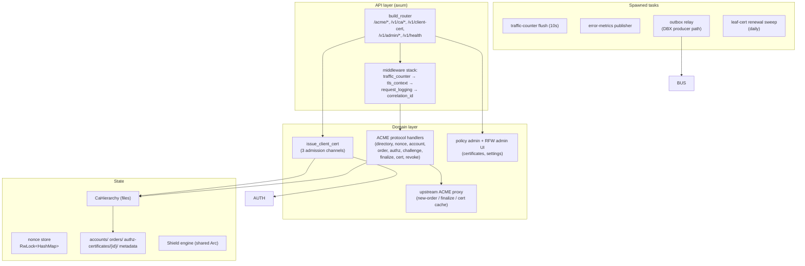

**Issuer-URL contract .** Two URL surfaces, each with exactly
one source of truth:

1. **Directory URLs** (`GET /acme/directory`) derive per-request from the
   incoming request's scheme + `Host` header - correct on any port or
   replica (auto-scale friendly). The registered SNI hostname
   (`acme.ops.sys.{SENTIN8_DOMAIN}`) is only the fallback when a request
   carries no `Host`.
2. **Resource URLs in account/order/finalize responses** (the
   `authorizations`, `finalize`, `certificate`, `Location` fields) are
   built from `AppState::issuer` - the DERIVED platform service base
   `https://acme.ops.sys.{SENTIN8_DOMAIN}`
   (`Sentin8Config::platform_domain("sentin8:acme")`), **port-free**. The
   captain-assigned listen port is never baked into a URL: the in-fleet
   consumer (the `sentin8-tls` on-demand resolver) pins the discovered
   instance IP:port via `reqwest`'s `.resolve(sni_host, addr)` - a DNS
   override where "ports in the URL itself always win" over the pinned
   address - so a port-bearing `issuer` would pin every follow-up request
   to ONE boot's ephemeral port and break on respawn, while the port-free
   form keeps the SNI correct AND routes via the pinned address. The
   platform ingress (`acme.ops.sys.{SENTIN8_DOMAIN}`, port 443 via
   Sentin8:Proxy) is the other port-free consumer of the same URLs.

**Boot sequence** (`server.rs::serve`): `CaHierarchy::ensure` (load or
generate) → trust-store install (OS + NSS, best-effort) → PG pool connect
(PG 18 check) → self-issue the bootstrap server cert for
`acme.ops.sys.{SENTIN8_DOMAIN}` (+ captain local-IP SAN) → Shield
`boot_full` (refuse-to-start on invalid policy text) → traffic-counter
flush loop → outbox-relay spawn → `Sentin8Tls::builder().bootstrap_cert(...)`
→ `tls.serve`.

**Offline CLI modes (CAMINT-1).** The same binary doubles as the
operator's CA-plane mint CLI - two flags, both offline (no network, no
database, no fleet interaction), both driven by the SAME engine the
service boots (`offline_config()` pins the per-mode data dir exactly as
`AcmeConfig::from_env` does, so a CLI mint and a service boot address one
store):

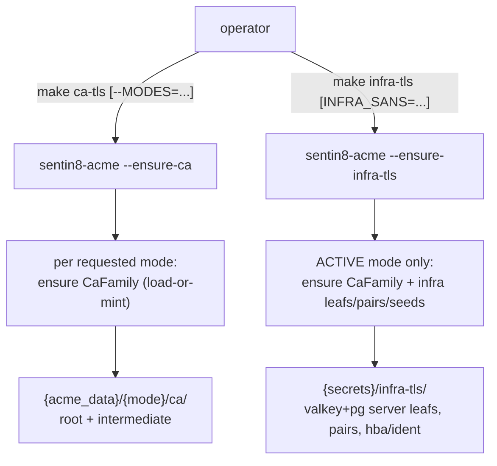

- `--ensure-ca [--modes=a,b,c]` ensures the CA hierarchy (root +
  intermediate) per requested mode - default is the ACTIVE mode, and the
  full set (`classical,hybrid,exclusive`) pre-stages every family. Safe to
  name multiple modes because CA material is per-mode directory scoped
  (PQCA-1): one mode's ensure never touches another's store.
- `--ensure-infra-tls` stays ACTIVE-MODE ONLY: the infra leafs are
  singletons at fixed paths (`{secrets}/infra-tls/*.crt`), so minting
  them for two families would overwrite each other; the material must
  match the running posture. It is family-aware (PQCA-2): under
  `classical` the leafs mint through the ECDSA `CaHierarchy`, under
  `hybrid`/`exclusive` through the PQ `PqCaHierarchy` - the CA chain copy
  (`{secrets}/acme-ca/root-ca.crt` = root + intermediate) is republished
  from the ACTIVE family on every run so verifiers always hold the chain
  that actually signed the leafs.
- **Leaf reuse is family-checked**: a still-valid leaf of the WRONG
  signature family is re-minted, never reused - the reuse predicate checks
  the leaf's signature-algorithm family (ECDSA vs ML-DSA) in addition to
  expiry and SAN coverage, so a posture flip (`SENTIN8_TLS_PQ_MODE`
  change) re-mints the infra plane instead of serving leafs the trust
  store cannot chain.
- `SENTIN8_ACME_DATA_DIR` (operator `.env`) is the ONLY data-dir source
  for both modes - no CLI override exists; the tree's `.env` is the single
  operator truth (the same rationale as the appliance hand-off contract).

### 4.0b Platform CA trust install - all three families (CATRUST-1)

`scripts/ca-trust.sh` publishes the platform CA into the OS and NSS trust
stores. It is an operator script, not a service side effect, for the
reason that makes the rest of this section necessary: the boot-time
install (`SENTIN8_ACME_INSTALL_TRUST_STORE`) publishes the ACTIVE
family's **root only**, best-effort, and the intermediate never reaches
the OS store at all (`server.rs` calls `install_to_os_trust_store` on the
root; `install_intermediate_to_nss` is NSS-only). A system verifier
anchored on that root therefore cannot build leaf -> intermediate -> root,
which is the failure shape behind `curl --cacert` and `openssl s_client
-CAfile` errors and behind Chromium's occasional path-building refusal.

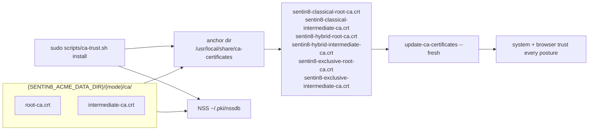

**All three families, or one by name.** `install` with no argument
publishes `classical`, `hybrid`, and `exclusive`; `install classical`
publishes one. The three are entirely different authorities with
mode-namespaced subjects (PQCA-3: `Sentin8 {Classical|Hybrid|Exclusive}
Root CA`), so installing all of them is not redundant - it is what lets a
posture flip work without a re-install.

**Every anchor filename carries its family.** This is the load-bearing
detail. An unnamespaced `sentin8-root-ca.crt` gives no way to tell a
classical root from an exclusive one, and the two are unrelated CAs -
verifying against the wrong one fails with the same "unable to get local
issuer certificate" shape as not trusting it at all. The script names
files `sentin8-{mode}-{root|intermediate}-ca.crt` and **deletes the
legacy unnamespaced names** (`sentin8-root-ca.crt`,
`sentin8-intermediate-ca.crt`, `sentin8-local-ca.crt`) on every install
and uninstall, so an ambiguous leftover can never be mistaken for another
posture.

**One file per certificate, never a bundle.** Debian's
`update-ca-certificates` copies each file in the anchor directory into the
bundle verbatim and does not split a PEM holding several certificates. The
published `{secrets}/acme-ca/root-ca.crt` is a two-certificate bundle
(root + intermediate), so installing that bundle as a single anchor would
make the *intermediate* the anchor and leave the root as an unverified
appendage. Six single-certificate files avoid that entirely.

**Commands.** `install [mode...]`, `uninstall` (alias `delete`, `remove`),
`status` (read-only, needs no privilege - it prints each anchor with its
classified kind and subject). `uninstall` removes every `sentin8-*.crt`
anchor plus the legacy names, refreshes the bundle, and clears the NSS
entries.

**Privilege.** `install`/`uninstall` write the system anchor directory and
rebuild the bundle, so both require root (one password prompt). `status`
does not. The NSS half writes the invoking user's `~/.pki/nssdb` via
`SUDO_USER`, and is best-effort because `certutil` is frequently absent.

**Test/sysroot mode.** `SENTIN8_CA_ANCHOR_DIR` overrides the detected
anchor directory and, together with `SENTIN8_CA_SKIP_REFRESH=1`, lets the
script run unprivileged against a staging directory (container images and
the install test do exactly this).

**Outbox relay - the DBX producer path.** Acme boots custom (not via the
shell), so `server.rs` spawns the shared outbox relay itself
(`sentin8::bus::outbox::spawn_relay`) with a `build_with_dcr` client for
the workload `sentin8:acme` (scope `sentin8:bus:produce`). **The Bus base
URL and the auth issuer are DERIVED, never hardcoded**: both fall back to
`sentin8::config::Sentin8Config::from_env()` (`sentin8_bus_url()` →
`https://bus.ops.sys.{SENTIN8_DOMAIN}`, `sentin8_auth_issuer()`), the same
derivation the shell boot uses for every service. There is no port
constant and no loopback IP anywhere in acme's Bus/Auth client paths - a
hardcoded `127.0.0.1:{port}` fallback is a defect class (the port is
captain-assigned per boot; a stale constant silently targets a dead
listener and the relay retries forever while rows pile up). The relay is
fail-open per the outbox pattern: a Bus outage or DCR failure only pauses
the push - rows persist in `acme.outbox` and the 5s safety poll retries.

**Request lifecycle - mTLS client-cert issuance (the security-critical
family):**

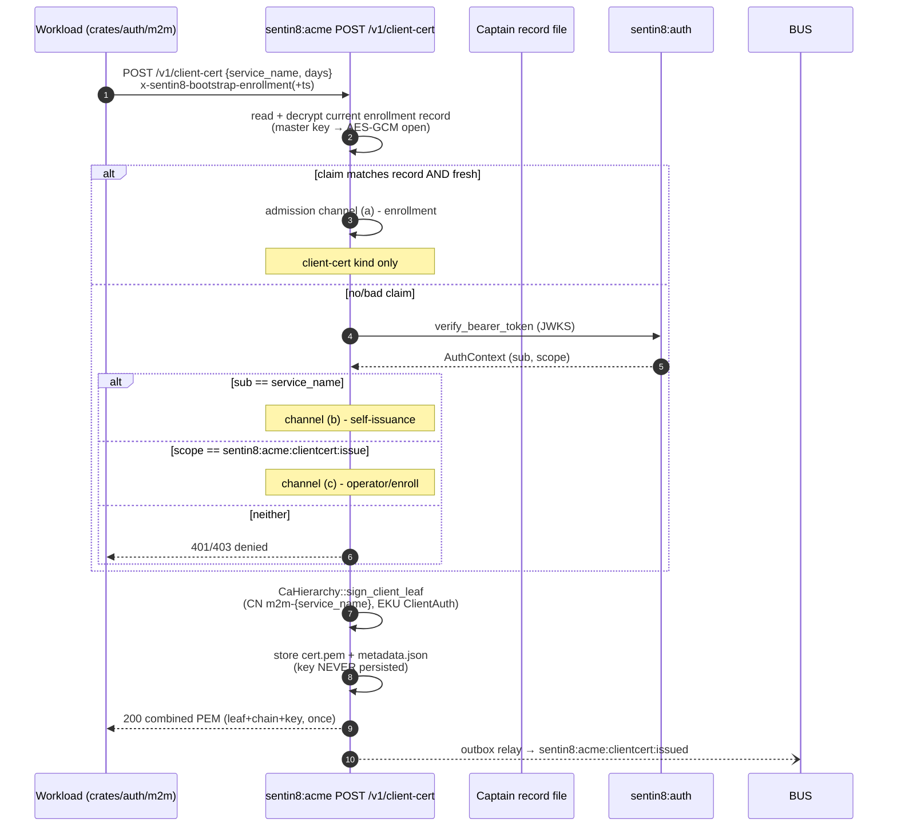

Failure branch: invalid `service_name` → 400; bearer verify failure → 401;
sub/scope mismatch → 403; issuance failure → 500 (caller retries on next
boot).

## 3. Data Model

Durable domain state is on the filesystem. Acme owns exactly ONE database
table - its own outbox (`acme.outbox`, the DBX producer durability for its
own events); the producer path is strictly local-outbox + Bus produce API
(architecture-principles §6.7 - no direct `bus.inbox` writes, no grants on
Bus's internal durability).

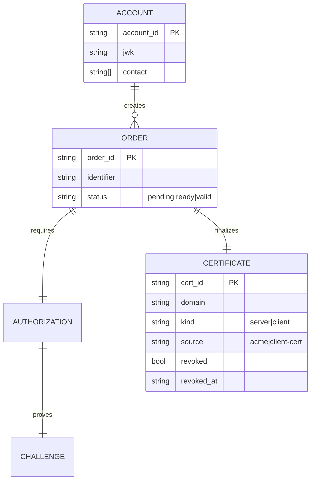

Filesystem layout under `$SENTIN8_ACME_DATA_DIR` - **per-PQ-mode subdirectory**
(PQCA-1): the operator sets `SENTIN8_TLS_PQ_MODE` once in the shared `.env`
(both planes source it); the acme data dir resolves as
`{SENTIN8_ACME_DATA_DIR}/{pq_mode}/` (`classical`, `hybrid`, or `exclusive`)
so every minted surface - CA hierarchy, accounts, orders, certificates -
lives in the mode's own directory. A mode flip populates the other
directory from scratch (a fresh CA per mode) and can never serve a leaf
minted for a different transport posture; host and appliance resolve the
SAME mode dir (the appliance mounts the base dir), so cross-plane
divergence is structurally impossible.

| Path (relative to `{data_dir}/{pq_mode}/`) | Content | Protection |
|------|---------|------------|
| `ca/root-ca.key`, `intermediate-ca.key` | CA private keys (SLH-DSA-PQ in the PQ families, ECDSA P-256 in `classical`) | 0600, never distributed |
| `ca/root-ca.crt`, `intermediate-ca.crt` | public CA certs | OS + NSS trust store install |
| `accounts/{uuid}.json` | ACME accounts | service-only |
| `orders/{uuid}.json`, `orders/authz-{uuid}.json` | order/authz/challenge state | service-only |
| `certificates/{cert-id}/cert.pem`, `key.pem`, `metadata.json` | leaf + key + metadata (`metadata.json` records `pq_mode` - the reuse-before-mint lookup filters on it) | keys 0600 |
| `upstream-account.json` | upstream ACME account key + kid (ES256) | 0600 |
| `.run/bootstrap-enrollment.json.enc` (captain-owned) | sealed enrollment claim | AES-256-GCM sealed, 0600 |

**CA families per mode (PQCA-2)**: the `classical` mode mints the ECDSA
P-256 chain via `rcgen` (the exact chain dev runs today). The PQ families
(`hybrid`, `exclusive`) mint a **post-quantum signature chain**: an
SLH-DSA-SHA2-128s root and ML-DSA-65 intermediate + leaves, built by the
in-repo X.509 builder (`x509-cert` + `ml-dsa`/`slh-dsa`; `rcgen` cannot
carry PQ signature algorithms). Served TLS in these modes carries
ML-DSA-65 handshake signatures through `sentin8-tls`'s custom
`SigningKey`/`KeyProvider` (rustls 0.23 accepts the ML_DSA_65 scheme on
TLS 1.3 suites) and verifies through the platform's PQ verification
algorithms (PQCLIENT-1: the pure-Rust ML-DSA/SLH-DSA
`SignatureVerificationAlgorithm` impls in `sentin8-tls`).

**The infra plane mints through the ACTIVE mode's family (PQCLIENT-2)**:
the PostgreSQL/Valkey server leafs and every infra client pair mint
through the active PQ mode's CA family - `classical` → ECDSA, `hybrid`/
`exclusive` → the PQ chain (SLH-DSA root, ML-DSA intermediate). The
sqlx transport that presents these keys is native-tls (system OpenSSL
3.5.x): OpenSSL parses ML-DSA-65 private keys and verifies ML-DSA
chains (verified live), so the Rust client plane serves the exclusive
posture on the data-plane links. Every non-sqlx TLS surface
(sentin8-tls service plane, reqwest, valkey-glide) runs the platform's
pure-Rust PQ provider (`install_platform_provider`). The infra
containers themselves are PQ-capable (the trixie PostgreSQL image and
the alpine Valkey image ship OpenSSL 3.5.x, verified to build, verify,
and handshakes ML-DSA-65/SLH-DSA certs with X25519MLKEM768) - the
server and client halves of every infra link share one crypto stack
under the exclusive posture. The service→service plane
(sentin8-tls terminated, Graviola + PQCLIENT-1 verification) carries
the exclusive posture; the browser edge stays classical until
Chromium's ML-DSA chain verification is confirmed on
this tree's build.

**The family dispatch is one function (`ensure_ca_family`)**: every
mint-or-load site (service boot, `--ensure-ca`, `--ensure-infra-tls`,
the client-cert endpoint, the renewal sweep) resolves the ACTIVE mode's
family through it - `classical` → the ECDSA `CaHierarchy`, `hybrid`/
`exclusive` → the PQ `PqCaHierarchy` - never by ad-hoc mode checks. The
RUNTIME serves the resolved family: `AppState.ca` holds the `CaFamily`
itself (the boot ensure returns it), and the runtime mint/serve sites
(`acme.rs` order issue + the renewal sweep) call the family's
`sign_leaf`/`sign_client_leaf`, which delegate to the classical or PQ
hierarchy by the same dispatch - an exclusive-mode acme instance mints
and serves ML-DSA leafs end to end. PQ
end-entity leafs mint through the CABF **Subscriber** profile
(`BasicConstraints ca:false`, `DigitalSignature`, EKU `serverAuth` +
`ClientAuth`) - never the `Subordinate` CA profile: an end-entity
certificate that can sign other certificates is a defect, not a
convenience (`sign_leaf` covers server leafs, `sign_client_leaf` the
mTLS workload pairs).

**CA subject names per mode (PQCA-3)**: every CA certificate's subject is
namespaced by the mode it was minted under, and the intermediate carries
the issuing service as its Organizational Unit. The two chains share one
naming helper (`ca_subject_common_names` in `src/ca.rs`), so a mode's
classical and PQ material can never drift apart:

| Mode | Root subject | Intermediate subject |
|------|-------------|----------------------|
| `exclusive` | `CN=Sentin8 Exclusive Root CA, O=Sentin8, C=CA` | `CN=Sentin8 Exclusive Intermediate CA, OU=Sentin8:ACME, O=Sentin8, C=CA` |
| `hybrid` | `CN=Sentin8 Hybrid Root CA, O=Sentin8, C=CA` | `CN=Sentin8 Hybrid Intermediate CA, OU=Sentin8:ACME, O=Sentin8, C=CA` |
| `classical` | `CN=Sentin8 Classical Root CA, O=Sentin8, C=CA` | `CN=Sentin8 Classical Intermediate CA, OU=Sentin8:ACME, O=Sentin8, C=CA` |

Three rules govern the subjects:

- **The root carries NO OU** (CABF BR 7.1.2.10.2 - the root CA subject
  admits only country, state, locality, postal, street, organization, and
  common name; the `x509-cert` builder's `cabf::Root` profile enforces
  this and the platform follows the standard). The intermediate carries
  `OU=Sentin8:ACME` (BR 7.1.2.10.2 admits OU on non-root CA subjects) -
  the OU names the issuing service so a chain view names its mint
  authority, while the root stays minimal per the profile.
- **The country is Canada (`C=CA`, ISO 3166-1)** on every CA subject,
  root and intermediate alike - one uniform nationality across both
  chains and all three modes.
- **The mode word is the CA's display identity.** PQCA-1 gives each mode
  its own hierarchy (own keys, own directory); PQCA-3 gives each hierarchy
  its own name so trust-store listings, browser chain viewers, and
  forensic timelines never show two distinct CA certificates under one
  subject.
- **The CN is derived at mint time, never stored** -
  `ca_subject_common_names()` reads `SENTIN8_TLS_PQ_MODE` through
  `sentin8::config::pq_mode()` (the same knob that scopes the data dir),
  so a hierarchy minted under a mode is named for that mode by
  construction. On load the issuer DN is parsed from the stored cert
  (the on-disk subject is the truth, never the env).

The leaf-signing paths stay DN-faithful to the on-disk issuer. The PQ
chain clones the issuer DN from the parsed on-disk intermediate cert
(`tbs_certificate().subject()`); the classical chain's rcgen issuer
reconstruction is built from the on-disk cert's subject DN
(`reconstruct_ca_cert_from_pem` parses the stored PEM and mirrors every
attribute in order) - the reconstruction never re-derives the DN from
the env, so a hierarchy minted under one mode keeps its subject when the
active mode later changes (the on-disk cert is the truth; the per-mode
directory boundary keeps fresh mints aligned with the active mode).
Existing hierarchies are never renamed on load - a mode directory minted
under an earlier name keeps that name until the operator wipes the data
dir (fresh mint takes the new name).

**Owned table - `acme.outbox`** (the service's ONLY table; FORCE-RLS'd on
`env_id`, drained by the local post-commit relay): `id` PK, `env_id`,
`event_type`, `stream_family`, `payload`, `publisher_id_token`,
`publisher_subject`, `relayed`, `relayed_at`, `relay_attempts`,
`next_retry_at` (the relay-visible backoff anchor - set by every failed
produce attempt: Bus's `retry-after` hint or the short-tick default;
`NULL` = immediately schedulable; the drain predicate skips rows whose
`next_retry_at` is in the future), `created_at`. Retry budget
`relay_attempts < 10` → exhausted rows park in place for manual
inspection/replay (never silently dropped).

### Database identity

Acme is a **bootstrap-tier service** - and the bootstrap tier rides the
same certificate identity as every other service (group DESIGN.md §3.2;
the old SCRAM-tier distinction is retired with the passwords):

- PG role: `sentin8_acme_service`, declared in acme's own
  `--print-registration --section=pg_roles` and created PASSWORDLESS by
  `vertical enroll`/`platform.sql`. The same pass writes the `pgm`
  identity-map row binding acme's workload CN (`m2m-acme` - the
  certificate `make infra-tls` pre-mints offline) to the role; the TLS
  handshake's `cert` auth decides the connection. There is no SCRAM
  hash to converge or drift.
- Privileges: USAGE on `public` (RLS helpers + the
  `sentin8_boot_policy_load` function) and DML on acme's OWN
  `acme.outbox` only - `cross_schema_grants` is EMPTY in the
  self-registration (the produce API replaced the direct `bus.inbox`
  INSERT path; no producer holds grants on Bus's internal
  durability tables, principles §6.7). Acme never reads another
  service's tables.
- DSN source: `SENTIN8_ACME_DATABASE_URL` (operator env; passwordless -
  the connection factory resolves the workload pair by role name).
  With no override, the DSN DERIVES from the service identity
  (`sentin8_config::service_database_url("sentin8:acme")` →
  `postgres: //sentin8_acme_service@{host}: {port}/sentin8`,);
  the legacy `DATABASE_URL` operator DSN is NEVER a fallback - under the
  superuser role the unqualified outbox INSERT resolves through the
  operator's `search_path` (`auth, sys, …`) and lands in another
  service's `auth.outbox`, where the foreign rows park at the retry cap
  (bus's gate 403s them) - the exact cross-schema write invariant
  7 forbids. The shell's VDC §VDC.3 wrong-database guard applies to
  whatever resolved.
- Failure posture: if the role, its identity-map row, or the workload
  pair is missing, acme exits at boot (fail fast). See §6.

## 4. API Surface

| Audience | Endpoint | Gate | Emits |
|----------|----------|------|-------|
| public (RFC 8555) | `GET /acme/directory` | none | - |
| public | `GET/HEAD /acme/new-nonce` | none (single-use in-memory nonce) | - |
| public | `POST /acme/new-account` | JWK in body | `sentin8:acme:account:created` |
| public | `POST /acme/new-order` | none (the `tls:exposure` map decides - an `external` entry relays upstream, §4.1) | `sentin8:acme:order:created` |
| public | `GET /acme/authz/{id}` | none | - |
| public | `POST /acme/challenge/{id}` | HTTP-01 check (local short-circuit) | - |
| public | `GET /acme/order/{id}` | none | - |
| public | `POST /acme/order/{id}/finalize` | authz `valid` enforced (local orders) | `sentin8:acme:order:finalized` |
| public | `GET /acme/cert/{id}` | none | - |
| public | `GET /.well-known/acme-challenge/{token}` | none (upstream HTTP-01 token echo) | - |
| public | `POST /acme/revoke-cert` | none (event-only path) | `sentin8:acme:certificate:revoked` |
| public | `GET /v1/ca/root.crt`, `/v1/ca/intermediate.crt` | none | - |
| workload | `POST /v1/client-cert` | bootstrap enrollment **or** `sub == service_name` **or** scope `sentin8:acme:clientcert:issue` | `sentin8:acme:clientcert:issued` |
| admin | `/v1/admin/policy-sets…`, `/v1/admin/relations…`, `/v1/admin/attributes…` | bearer + Shield (`sentin8:acme:admin` / policy scopes) | - |
| admin | `GET /v1/admin/ui/{page}`, `GET /v1/admin/{resource}`, `POST /v1/admin/certificates/{id}/revoke` | Shield | - |
| health | `GET /v1/health` | none | - |

**Event flow (local outbox → Bus → trigger):**

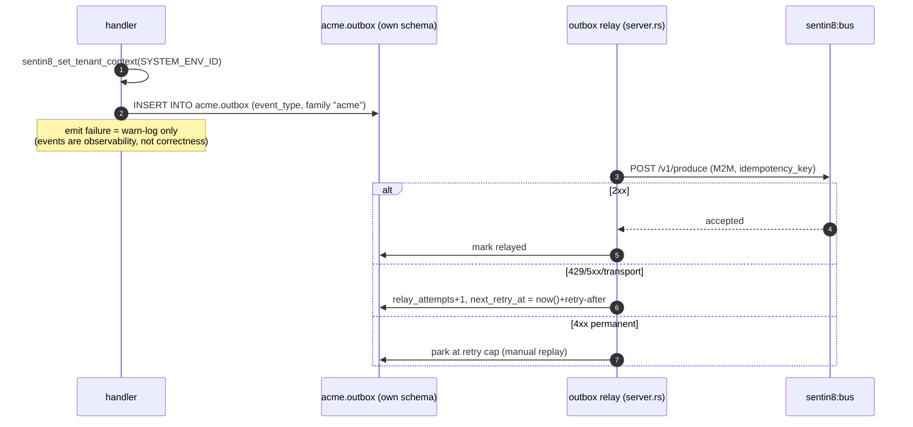

Consumers: none registered (`event_triggers: &[]`) - acme events are
observability/audit signal.

### 4.0 Reuse-before-mint at finalize

`POST /acme/order/{id}/finalize` for a LOCAL order checks the cert store
FIRST: when a non-revoked, unexpired certificate for the SAME domain
already exists, the order is finalized against that existing certificate
(its `/acme/cert/{id}` URL) with NO new signing and NO new cert directory.
Only on a miss does the platform CA mint a fresh leaf.

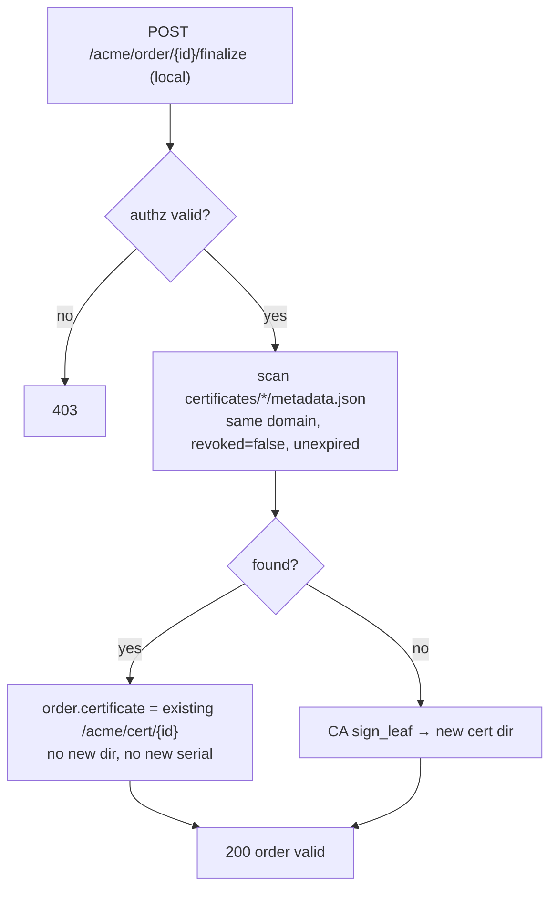

- **Why:** the service plane (`sentin8-tls`) persists its minted leaves
  (tls README §6.5) and pre-warms from disk at boot, so the *steady-state*
  mint volume is near zero; but restarts, resets, and cache misses still
  re-request the same domains. Without reuse, every such request mints a
  fresh leaf and directory (52,761 dirs / 650 MB observed before this
  rule; ~19 mints/day for `auth.ops.sys…` alone during reset cycles).
  Reuse makes the re-request idempotent: same domain within the leaf's
  lifetime ⇒ same certificate returned.
- **Scan bound:** the store scan reads only `metadata.json` files
  (mtime-windowed, newest first) - it is not a crypto operation and does
  not need the PEM; a store without a hit costs one directory walk.
- **Revocation interaction:** a revoked certificate is never reused;
  revocation forces a genuinely fresh mint on the next finalize.
- **External orders (upstream source) reuse too - ISSUER-CHECKED
  (RIGMODE-1):** the scan distinguishes `source`; an upstream-signed
  live leaf ends ONLY an external order (RIGMODE-1's rate-limit motive:
  a public CA's issuance limits are per-domain-per-week, so a fleet
  restart that re-orders an existing valid leaf against Let's Encrypt
  burns allowance for nothing; with reuse the re-finalize is idempotent
  against the relay cache). The cross-source case is the mode-flip
  story: after `platform` -> `public`, the domain already carries a
  live platform-CA leaf - a source-blind hit would return it and the
  upstream-issued expectation would never materialize; the source
  filter forces the fresh upstream order (and vice-versa: a local
  order never re-uses an upstream leaf). The reuse hit also completes
  WITHOUT the upstream round trip - the order never re-opens the
  upstream's authz.
- **Concurrent finalize race:** two concurrent finalizes for the same
  domain may both miss and both mint - the last writer wins the order
  URL and both certs remain valid leaves (the caller's persisted pair is
  whichever it downloaded first); this is the same at-most-once outcome
  ACME renewal already permits and is acceptable for the dev/posture this
  rule serves.

### 4.0a Reuse-before-mint at new-order (the order-site guard)

The §4.0 rule lives at **finalize**; the CERTTIER-1 public-mode run
(2026-11-20) proved it must ALSO live at **new-order**. That run burned
1920 upstream orders in one afternoon - 1739 of them tier-B internal
names before the allowlist existed, and the rest the same retry shape:
every failed fetch cycle re-`new_order`ed a FRESH upstream order before
any finalize (where §4.0's reuse would have caught it) ever ran.

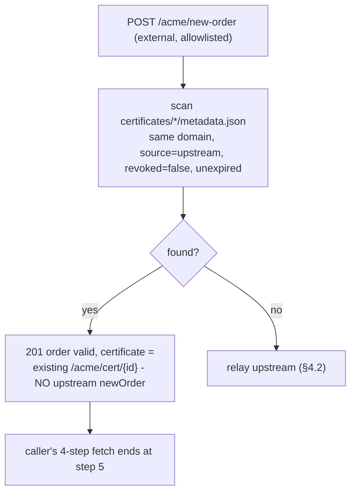

- **Why the order site:** a public CA counts rate limits at
  `newOrder` (LE production: 300/account/3h, and the GLOBAL
  50 per registered domain per week shared across every account and
  customer on that domain). A retry loop that re-orders before
  finalizing drains both - per-domain lockouts cannot be overridden
  and block issuance for a week. Relaying an order for a domain whose
  live upstream leaf is already cached is a pure waste; the caller
  only wants A certificate for the domain, not THIS order's.
- **What it returns:** the same shape the finalize-side reuse returns
  - a 201 whose `certificate` field points at the cached
  `/acme/cert/{id}` and whose `status` is `valid`. The
  `sentin8-tls` 4-step fetcher treats it identically (its finalize
  POST hits the reuse path, idempotent, and it downloads the cached
  PEM); no separate response shape, no client-side change.
- **Source filter unchanged (§4.0):** only `source:"upstream"` leafs
  satisfy external reuse - a platform-CA leaf never ends an external
  order, and vice versa.
- **DNS-01 orders included:** a wildcard order against a cached
  wildcard leaf reuses identically (the domain value is `*.{zone}`,
  matching the cached cert's domain).
- **Reuse-before-mint applies to every external order.** A hit returns the
  cached leaf at the ORDER site (§4.0a) - the guard removes redundant order
  creation, it never changes the classification.

### 4.1 Domain classification policy

Every order is classified **internal** or **external** at
`POST /acme/new-order` time. The decision is a lookup in a published
exposure map - never DNS, never hostname parsing, never a per-name env
list.

**The declaration is made at enrollment, by the thing that knows.**
A service declares its exposure in its registration; an app instance
declares it when created. The declaration is published to Valkey under
`tls:exposure` (§4.1b) and acme reads it at boot into an in-memory map.

```
tls:exposure  (Valkey hash)
  field: hostname or `*.{zone}`      value: "external"
```

Rules:

- **Most-specific match wins.** An exact hostname beats a zone entry.
  This is what makes `dash.ops.sys.{root} → external` coexist with
  `*.ops.sys.{root} → internal`.
- **Unknown ⇒ internal.** A hostname with no entry is signed by the
  platform Intermediate CA. Fail-safe: an unpublished name never reaches
  a public CA.
- **Built-in internal forms** need no entry: `localhost`,
  `*.localhost`, `*.local`, and RFC 1918 loopback/private literals
  (`127.*`, `10.*`, `192.168.*`, `172.16.*`-`172.31.*`).
- **Mixed orders are rejected** (`400 urn:…:malformed`) - a certificate
  must not mix platform-CA-signed and upstream-signed names; the trust
  chains are disjoint.
- **Internal orders** are signed directly by the Intermediate CA at
  finalize, after their HTTP-01 challenge short-circuits to `valid`.
- **External orders** relay to the upstream provider
  (`SENTIN8_ACME_UPSTREAM_DIRECTORY_URL`). When no upstream is
  configured, an external order is **rejected** - never silently
  downgraded to the platform CA, because the name is publicly resolvable
  and the platform root is not in the public trust store.
- Classification is decided once per order and stored in the order record;
  the finalize path re-derives and re-checks it (defense in depth).

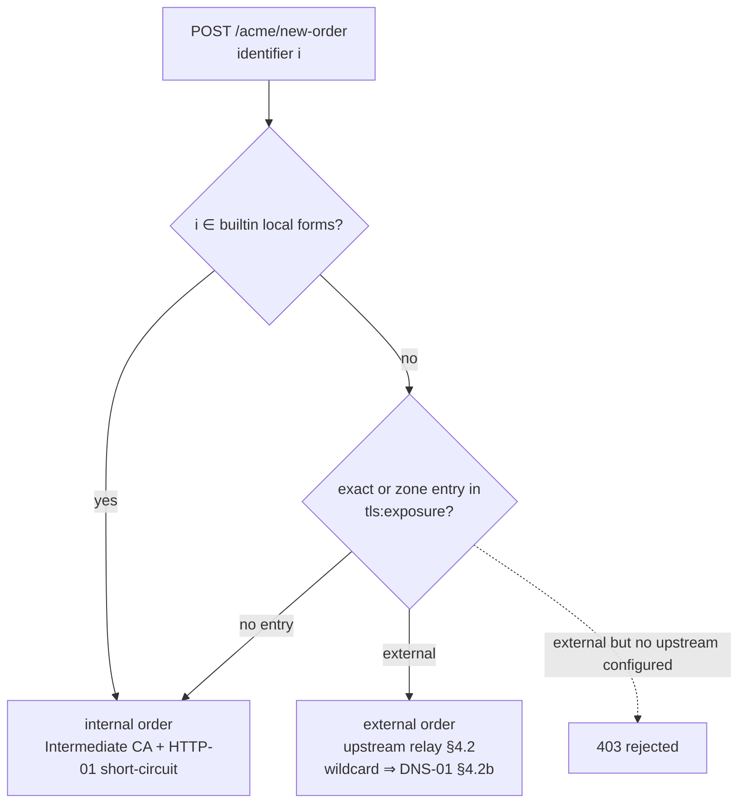

### 4.1a Why some hosts must be public - the browser chain

A certificate needs a publicly-trusted CA **only when the TLS client of
that hostname is an arbitrary, unmanaged browser**. The decisive fact is
that this need is **transitive along the browser's redirect chain**: if
`dash.ops.sys.{root}` redirects the browser to
`auth.ops.sys.{root}/oauth/authorize` (`sentin8-bff/src/handlers.rs`,
`resolve_tenant_sentin8_auth_url` → `sentin8_auth_base_url`), then
**both** must be publicly trusted. Making one public and leaving the
other on the platform CA yields a page that loads and a login that dies
with `ERR_CERT_AUTHORITY_INVALID`.

So the `external` set is a **connected component of the browser flow**,
not a per-hostname preference:

| hostname | external? | why |
|---|---|---|
| `dash.ops.sys.{root}` | yes (declared) | the operator's entry point for an unmanaged browser |
| `auth.ops.sys.{root}` | yes (required) | every login redirects here from `dash`/`bff` |
| `bff.ops.sys.{root}` | yes (required) | the SPA's API + session surface |
| platform service plane | no | dialed by services, verified by the mTLS client |

**The mTLS consequence.** Internal callers verify peer server
certificates through `build_mtls_client`, which historically trusted the
platform CA **only** (`sdk/core/middleware/src/mtls.rs`: a single
`add_root_certificate`, no `tls_built_in_root_certs`). An external
`auth.ops.sys` is therefore only reachable by the fleet if that client
also accepts the upstream CA. The client gains
`SENTIN8_ACME_UPSTREAM_CA_PEM` as a second root - exactly the CA that
signed the hostnames, not arbitrary public roots.

**What does NOT change:** client-certificate verification (the workload
identity channel) is server-side and remains platform-CA-only
(`acceptor.rs` builds its `WebPkiClientVerifier` store solely from
`client_ca_pem`). The CN → role mapping, Shield authorization, and the
workload registry are untouched. No code uses a *server* certificate's
issuer as an authorization signal.

### 4.1b The exposure map - declared at enrollment (TLS-EXPOSURE-1)

The map lives in Valkey, written by the enrollment/app-creation plane and
read by acme - the same shape as `m2m:workloads`
(`sdk/identity/workload-registry`): enroll-side writer identity,
boot-loaded snapshot, TTL refresh, no database access in the consumer.

```
Valkey hash   tls:exposure
  field  = exact hostname, or `*.{zone}`       (most-specific wins)
  value  = "external"                          (absence ⇒ internal)
```

**Writers:**

| Writer | Publishes |
|---|---|
| `vertical enroll` | each service's declared exposure: `{subdomain}.ops.sys.{root}` for the platform plane, plus `{subdomain}.{env_domain}` for every env of every org |
| app instance create (`POST` install) | the instance's `hostname` and `sentin8_bff_hostname`, taken from the listing's `visibility` - `public` ⇒ external, `env`/`usr` ⇒ internal |

Both writers use an owner ledger (`tls:exposure:owners`), so a re-run
removes that owner's previous hostnames before publishing the fresh set -
convergence, not accumulation. Services publish under
`service:{service_type}`; instances under `app-instance:{id}`, which keeps
two installs of the same listing from clobbering each other.

The app publish is **best-effort**: a Valkey outage must not fail an
install, and the fallback is the platform CA - the safe default, since an
undeclared hostname never reaches a public CA.

**Reader:** acme boots the map once (`boot_load`, TTL refresh loop) and
the order path reads the in-memory snapshot - zero I/O per order, zero
database.

**Why not captain-propagate it as env?** A static env map
(`SENTIN8_TLS_PLATFORM_LABELS` style) works for platform services, but
app instances are created at runtime per tenant - captain cannot
enumerate them at boot. Valkey covers both, and acme already links
`valkey-glide`.

**Why not a Sys lookup?** Sys answers "who owns this hostname", not "may
this hostname be public". The exposure decision is a declaration by the
owner, published once at enroll/app-create; a per-order lookup would add
a cold-mint network edge for data that is already known.

**The operator override - `SENTIN8_ACME_FORCE_INTERNAL=true`.** Some
deployments must never reach a public CA regardless of what is declared:
air-gapped rigs, offline appliances, and any box whose outbound path to a
public ACME directory is blocked. The flag makes the platform CA the only
issuer: every `external` entry is ignored, every order short-circuits to
the Intermediate CA, and **the upstream client is never constructed** -
`AppState.upstream` is `None`, so there is no outbound ACME path in the
process at all. It is checked before the map, so a stale `external` entry
cannot leak an order outward. This is the deliberate, auditable escape
hatch - the inverse of fail-open, and the one switch that turns the whole
exposure mechanism off.

| `SENTIN8_ACME_FORCE_INTERNAL` | `..._UPSTREAM_DIRECTORY_URL` | behaviour |
|---|---|---|
| `true` **← the default** | any | platform CA only; upstream client not built |
| `false` / unset | set | `external` entries relay upstream |
| `false` / unset | empty | external orders **rejected**, never downgraded |

`SENTIN8_ACME_UPSTREAM_CA_PEM` is NOT part of this switch - it is only an
outbound trust pin for the TLS connection to the upstream. Empty means
"verify the upstream against the system roots", which is the normal case
(Let's Encrypt via the OS store).

**Always test against staging.** `SENTIN8_ACME_UPSTREAM_DIRECTORY_URL`
must point at
`https://acme-staging-v02.api.letsencrypt.org/directory` for any test
run: production Let's Encrypt enforces 50 certificates per registered
domain per week, and a failed conformance battery can consume that budget
in one pass. `sentin8 captain services` prints this as an `ACME` line
under `Infrastructure:`, calling out production Let's Encrypt by name so
a misconfigured rig is visible before a battery runs.

**Unit tests never dial a CA.** The acme test suite asserts on the
directory URL as a value (`may_order_external`, decision matrix) and
otherwise points `upstream_directory_url` at a local mock server. Any
literal appearing in tests is `https://acme.invalid/...`, so a test can
never reach a real CA even by accident.

**Conformance rig modes (RIGMODE-3).** The rig selects the **issuer**,
never the domain. `SENTIN8_DOMAIN` comes from the tree `.env` - a
different domain means a different CA, different enrolled hostnames, and
different leaves, i.e. a fleet reset rather than an override.
`start-conformance` refuses to boot when the override file carries
`SENTIN8_DOMAIN`.

**All-local is the default, everywhere.** `SENTIN8_ACME_FORCE_INTERNAL=true`
is the shipping `.env.example` value and the value a rig starts with; the
upstream mode is an explicit, deliberate opt-in for one campaign. That
ordering is the safety property: an operator who never thinks about the
issuer gets the platform CA, not a public-CA dependency.

| target | issuer |
|---|---|
| `conformance-acme-internal` (DEFAULT) | platform CA for everything; no upstream client is built |
| `conformance-acme-upstream` | upstream for enrolled `external` names, platform CA otherwise |

### 4.2 Upstream ACME relay

External orders are fulfilled by a **real RFC 8555 client** running in
acme's process (shared `upstream` module) against the configured public
CA directory. There is no pass-through of caller JSON to the upstream -
acme terminates the platform's own simplified protocol and speaks
standards-compliant ACME outbound:

- **Account**: ES256 account key generated once, persisted at
  `upstream-account.json` (`upstream_account_path()`, 0600) alongside its
  kid; registered against the upstream `newAccount` endpoint on first
  external order (contact from `SENTIN8_ACME_UPSTREAM_CONTACT`). The
  file is per-PQ-mode-dir only - it is NOT namespaced by directory: the
  same file carries the account for WHICHEVER upstream the process is
  configured against. A directory switch (staging → production) with
  an un-migrated file makes acme present the old directory's kid to the
  new one - a permanent 400/401 on every order until the file is moved
  aside (the migration on 2026-11-20 parked it as
  `upstream-account.staging.json`; the operator re-registers fresh on
  first production order).
- **Every request is JWS-signed** (RFC 8555 §6.2: ES256, `kid` or
  embedded JWK for the initial newAccount, nonce from a fresh
  `newNonce` fetch, `url` header matching the target, `Content-Type:
  application/jose+json`).
- **Orders**: `newOrder` for the identifier; the upstream's authz list is
  inspected to find the **http-01** challenge, whose token is stored
  in-memory (bounded map) and served back to the internet by the proxy's
  HTTP-01 listener (§4.3).
- **Finalize**: acme generates a real PKCS#10 CSR (rcgen `KeyPair` +
  `CertificateParams::serialize_request`, CN/SAN = the ordered domain,
  key owned by acme - never the caller's placeholder), submits it, polls
  until `valid`, then downloads the cert chain and caches it under
  `certificates/{id}` with `source: "upstream"`.
- **TLS to the upstream**: a dedicated reqwest client built on the
  **hybrid** PQ provider (`SENTIN8_TLS_PQ_MODE=hybrid` composition - the
  platform's exclusive provider speaks only X25519MLKEM768, which public
  ACME endpoints don't offer; the relay must negotiate classical
  classical TLS 1.3 to reach them). The client verifies the upstream
  against the system roots, optionally pinned to
  `SENTIN8_ACME_UPSTREAM_CA_PEM`.

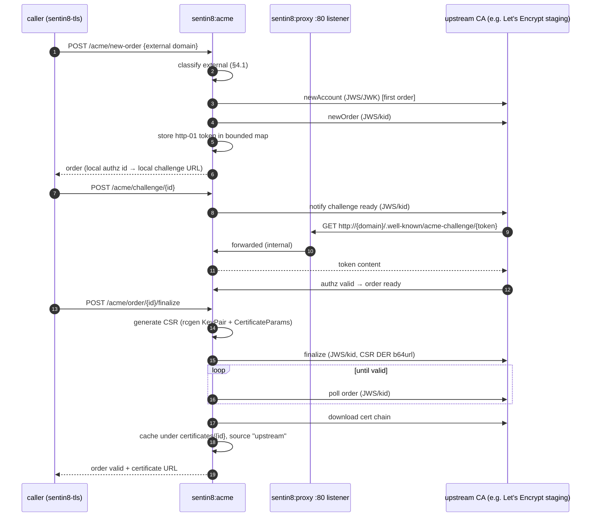

Failure branches: upstream 4xx `malformed`/`unauthorized` → mapped to a
`400` with the upstream problem detail (no retry - permanent);
`badNonce` (200 with problem doc) → refetch nonce and resend once;
transport/5xx → `502` + the relay stays retryable (order record keeps
status `pending`; the caller's finalize re-drives it). Cert download
failure after `valid` → `502` + order record keeps `certificate` set so
the next finalize completes it.

### 4.2b Upstream DNS-01 challenge - wildcard orders (CERTWILD-1)

HTTP-01 (§4.3) cannot validate a wildcard identifier - RFC 8555 §8.4
requires DNS-01 for `*.{env_domain}`, the per-env wildcard that
collapses tier A's browser plane (§4.1a) to ONE upstream order. The
relay therefore carries a second challenge type, selected per
identifier shape:

- **Identifier shape decides the challenge, never the operator**:
  a wildcard identifier (`*.` prefix) routes to DNS-01; a plain
  hostname keeps HTTP-01. No configuration knob flips the selection -
  the wrong pairing is a protocol impossibility, not a choice.
- **TXT record automation**: the challenge's `keyAuthorization`
  (`token.accountKeyThumbprint`) is published as `_acme-challenge`
  TXT records through a **DNS provider API** integration - the operator
  configures ONE provider profile (env:
  `SENTIN8_ACME_DNS_PROVIDER`, `SENTIN8_ACME_DNS_API_TOKEN` ref via
  Sentin8:Secrets, `SENTIN8_ACME_DNS_ZONE`, and the optional
  `SENTIN8_ACME_DNS_API_BASE` override for test rigs/mirrors), and acme
  publishes the TXT record at new-order time and clears it when the
  order resolves (or dies). No manual DNS copy flow.
- **Provider scope**: the integration is a bounded set of well-known
  DNS APIs - currently **Cloudflare** (REST v4 zone API, an API token
  scoped to `Zone.DNS:Edit` on the challenge zone only, never the whole
  account). A provider name outside the set fails the BOOT (a typo
  silently degrading wildcard orders to reject-at-new-order hides the
  misconfiguration). The record lifecycle is publish-idempotent (a
  live identical record is a no-op; a foreign record set at the
  challenge name is replaced) and clear-on-resolve (the token-to-record
  map keys every publish; `forget_token` clears it).
- **Failure posture**: a DNS-01 order with no provider configured is
  rejected at new-order with `400 rejectedIdentifier` - "wildcard
  identifiers require the dns-01 challenge but no DNS provider is
  configured" (fail-closed, same posture as proxy-off external names -
  never a fallback to a challenge that cannot validate the shape).
- **Reuse-before-mint applies unchanged** (§4.0): a wildcard
  upstream leaf is cached with `source: "upstream"`, domain
  `*.{env_domain}` - restarts re-finalize against the cached leaf
  and burn no upstream orders (the RIGMODE-1 rate-limit motive,
  amplified by wildcards' tighter public-CA rate limits).
- **Wait bound**: the DNS-01 validation window adds to the poll loop
  (§4.2's poll-until-valid) - the upstream re-checks the TXT record on
  its own schedule; the mint fetch wait (sentin8-tls
  `CERT_FETCH_WAIT_S` = 90s) covers one validation cycle, and the
  failure backoff bounds retry storms as it does for HTTP-01.

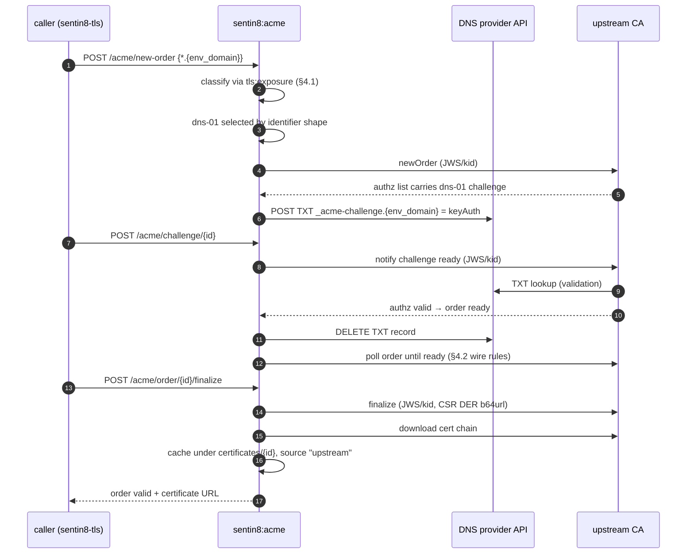

**Wire rules proven live (CERTTIER-1 public-mode run, 2026-11-20).**
Three protocol details the relay gets right only with deliberate care -
each was a live failure before its fix, and each is pinned by the
integration suite:

- **The challenge response carries `{}`, never POST-as-GET**
  (RFC 8555 §7.5.1). The payload field of the challenge-response JWS
  is `base64url({})` - the empty JSON object tells the CA "begin
  validating". An empty-STRING payload (§6.3 POST-as-GET) only READS
  the challenge: the CA answers 200 with the still-pending challenge
  and never runs its validator. Two orders sat `pending` for 40+
  minutes this way - the token servable from three continents, the
  notify silently a read. (`post_kid_empty_payload` stays only for
  the POST-as-GET resources: order poll, cert download.)
- **The key authorization is `token.Thumbprint`, ONE hash** (RFC 8555
  §8.1 + RFC 7638): the digest half is the account key's RFC 7638
  thumbprint itself - `base64url(SHA-256(canonical JWK))`. A
  double-hash form (SHA-256 over the thumbprint STRING) failed LE's
  validator with a keyAuthorization mismatch
  (`Expected "<token>.pLA8..." got "<token>.u3SK..."`). The thumbprint
  helper (`jwk_thumbprint`) is the single source of the digest.
- **Finalize waits for `ready`** (RFC 8555 §7.4): the finalize
  pre-polls the upstream order until it leaves `pending` (`ready`/
  `processing`/`valid`, bounded ~60s) BEFORE submitting the CSR - a
  public CA validates asynchronously (LE staging: 10-60s), and a CSR
  against a `pending` order is a guaranteed `orderNotReady` 403.
  **The challenge proof survives a failed finalize**: the token-map
  entry (and the dns-01 TXT record) is cleared only on the SUCCESS
  path (or a terminal `invalid`) - a transient failure (502, an early
  retry racing the validator) must leave the proof servable, because
  the validator fetches on its own schedule and the caller's
  re-finalize drives it forward. Dropping the proof on a transient
  reject made every later retry permanently unvalidatable.

### 4.3 HTTP-01 challenge serving

Local orders short-circuit (§4.1). External orders prove control via the
REAL HTTP-01 flow: the upstream fetches
`http://{domain}/.well-known/acme-challenge/{token}` on port **80**.
Sentin8:Proxy owns every ingress port, so the proxy binds an optional
plain-HTTP listener (`SENTIN8_PROXY_HTTP_PORT`, default 80) whose ONLY
purpose is `/.well-known/acme-challenge/*` - everything else is a fixed
`404`. The listener forwards challenge requests to acme, which echoes the
token content (`token = base64url(sha256(domain + '.' + token))`-style
echo is NOT used; acme serves the token payload as-is for the relay
because it is the authorizing party - it stored the upstream's token at
newOrder time). Requests are unauthenticated by design (RFC 8555 §8.1).

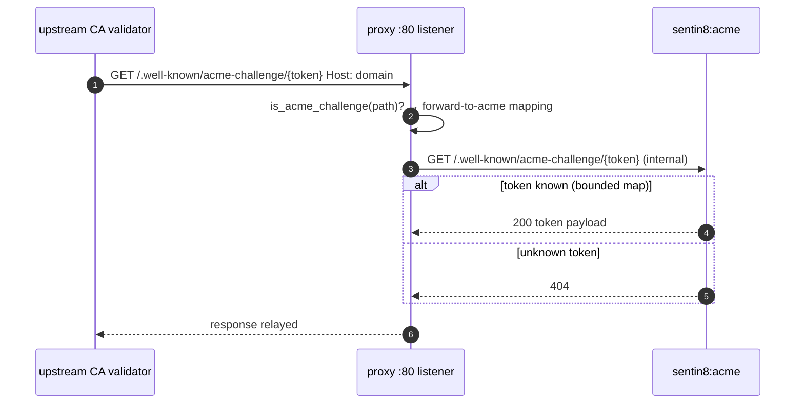

Prerequisite for external issuance: the operator's public domain must
actually resolve to the dev box AND port 80 must be reachable from the
internet (the wildcard-zone trick covers name resolution; reachability
is physical). Test upstreams (Let's Encrypt **staging** -
`https://acme-staging-v02.api.letsencrypt.org/directory`) avoid
production quota burns.

## 5. Cross-Cutting Concerns

- **Authentication**: three independent admission channels for client-cert
  mints (enrollment, self-issuance, operator scope); admin endpoints verify
  via the shared auth client (JWKS cached) then evaluate Shield.
- **Tenant resolution / RLS**: single-tenant platform service - all writes
  set the SYSTEM env context explicitly in an explicit transaction.
- **TLS posture**: in-process PQ termination via `sentin8-tls`; the
  bootstrap cert is self-issued from its own CA at boot (chicken-and-egg
  break); SNI `acme.ops.sys.{SENTIN8_DOMAIN}`.
- **Audit**: mints at the enrollment channel are logged at `warn` (always
  visible in the audit trail); events to `inbox` carry actor/service ids.
- **Rate limiting**: none implemented (nonce store enforces single-use
  nonces only).
- **Graceful drain**: `Sentin8Tls::serve` graceful shutdown (drains
  in-flight connections on SIGTERM).

## 6. Failure Modes & Recovery

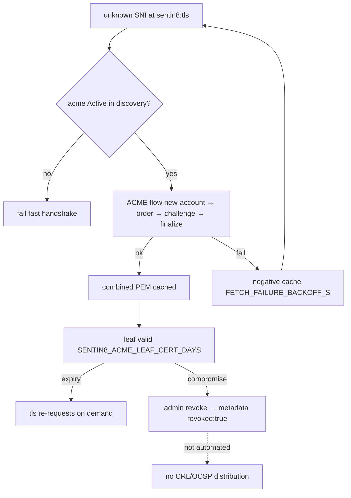

- **CA loss**: `ca/` is preserved across database resets; a deleted CA dir
  is regenerated - every previously issued leaf then fails validation until
  re-issued (fail-closed, trust anchor is the source of truth).
- **PG role missing / password drift**: acme exits at boot with the
  password-auth error. This is a fleet-wide outage seed, not a local
  degradation: without acme, every service's `sentin8-tls` cannot resolve
  leaf certs, all `https` health probes fail, and the captain kill-loop
  gives up on the whole fleet. The role is created by `platform.sql`
  (bootstrap-tier SCRAM seed) and re-verified idempotently - a role whose
  SCRAM hash predates the operator DSN is reseeded at bootstrap so a
  database-only reset can never strand the role.
- **Enrollment claim staleness**: the record file is read fresh per
  request; the env copy is only a fallback; both fail-closed.
- **Upstream proxy outage**: new-order/finalize → 502; cert download served
  from the local cache.
- **Outbox emit failure**: warn + drop (at-least-once not required - events
  are advisory).
- **Outbox relay unreachable Bus**: the relay backs off and retries (2s
  then 5s cadence); rows accumulate in `acme.outbox` with
  `relay_attempts` capped. The Bus base URL is the config-derived
  platform domain (`https://bus.ops.sys.{SENTIN8_DOMAIN}`), so this path
  only fails while Bus itself is down or the DCR token source is not yet
  activated - never because of a wrong address. Recovery is automatic
  once Bus responds (the safety poll drains the backlog).

### 6.1 Mint admission control - bounded queue + load shed (ACME-PREF)

A fleet-wide cold start re-dials EVERY service's cert fetch at once; the
mint path (`new-order` → `finalize`, several CA-signing round-trips per
mint) is CPU-bound rcgen work. Unbounded, a storm saturates the mint path
until callers time out silently - which cascades: captain's probe
watchdog counts the dead handshakes, mass-kills the just-started victims,
and each respawn re-enters the storm. The shed answers overload UP FRONT
with a clear refusal instead of a silent timeout:

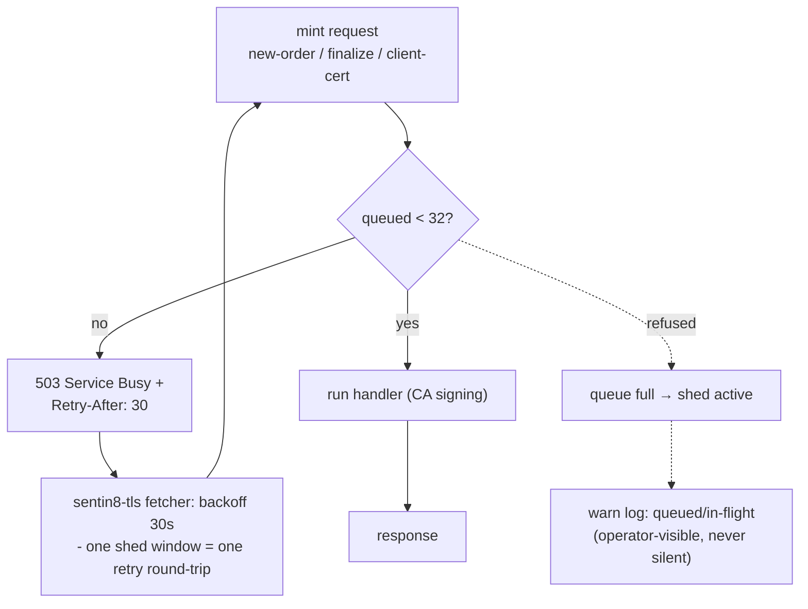

- **Exempt paths (never shed)**: `/v1/health`, CA downloads
  (`/v1/ca/*.crt`), cert downloads (`/acme/cert/{id}`) - cheap reads, and
  the recovery path itself must never be shed.
- **Constants** (pinned by a test): `MAX_QUEUED_MINTS = 32`,
  `SHED_RETRY_AFTER_S = 30` (matches `sentin8-tls`'s
  `FETCH_FAILURE_BACKOFF_S` so one shed window equals one client retry
  round-trip - no thundering re-entry), `MAX_CONCURRENT_MINTS = 16`.
- The refuse answer is deliberately a **503 with `Retry-After`**, never a
  hang: the fetcher's failure path is deterministic and its negative
  cache prevents hot-looping, so a shed window self-drains instead of
  holding handshakes hostage.
- Observability: every refused request warn-logs the queue depth and
  in-flight count - the shed is always auditable, never silent.

## 7. Concurrency & Performance Model

- Single axum server task (in-process TLS); per-request handlers are
  stateless apart from the nonce `RwLock<HashMap>` and the CA hierarchy
  loaded once into `AppState`.
- Certificate minting is CPU-bound but bounded: the mint endpoints share
  ONE admission queue (`shed::MintLimiter`, ACME-PREF §6.1) - bursts
  queue up to 32 deep, then refuse deterministically (503 + Retry-After)
  instead of stacking unbounded handler tasks and starving the process's
  other duties (outbox relay pool, health, admin). Health/CA/cert reads
  bypass the limiter entirely.
- Traffic counter flush every 10s to Valkey (`stat:metrics` channel).
- On-demand SNI issuance blocks one handshake task (bounded 15s poll,
  concurrent fetches deduped) - the negative cache prevents hot-looping.
- Outbox relay: local `acme.outbox` drain via the shared relay (LISTEN
  wakeup + 5s safety tick); `next_retry_at` paces per-row retries after
  a failed produce (Bus's `retry-after` hint or the 2s short tick) so a
  saturated Bus never burns the retry budget on hot-loop.

## 8. Invariants, Insecure-Defaults Rejected, Unsafe Rationale

1. **CA private keys never leave the data dir** - only public certs are
   served; `SENTIN8_ACME_DATA_DIR` is never propagated to other services.
2. **Client-cert private keys are never persisted server-side** - the
   combined PEM is returned exactly once.
3. **Enrollment channel can mint client certs only** (`kind: "client"`),
   never server leafs - the CN prefix is the scope boundary.
4. **The enrollment claim is verified against the CURRENT captain record**
   read fresh from disk per request - never against a spawn-time env copy.
5. **Fail-closed CA resolution** - no unauthenticated minting; no
   `danger_accept_invalid_certs` anywhere; callers trust only the platform
   Root CA.
6. Keys on disk are 0600; the trust-store install is best-effort and never
   gates startup.
7. **Bootstrap-tier DB identity is declared, not assumed** - acme's PG
   role (`sentin8_acme_service`) is declared in its own `pg_roles`
   registration and created with the bootstrap-tier SCRAM password by
   `platform.sql`; acme must never silently fall back to the shared dev
   role, and must never declare another service's role.
8. **Mint overload sheds UP FRONT, never silently** - when the mint
   queue is full, acme answers 503 + `Retry-After: 30` (the pinned
   backoff window) rather than accepting work it cannot run in time;
   health/CA/cert reads are never shed; every refusal is warn-logged.
9. **Classification is offline and deterministic** - the decision is an
   in-memory lookup in the boot-loaded `tls:exposure` snapshot (builtin
   local forms + declared entries). Never a DNS lookup, never a database
   read, never hostname parsing.
10. **The platform CA never signs an unproven external domain.** An external
    identifier with proxy mode off is rejected at new-order. With proxy
    mode on, the platform CA still never signs it - the upstream CA
    does, after HTTP-01 succeeds against the proxy's :80 listener. The
    local finalize path re-checks the order's authz is `valid` before
    signing (defense in depth).
11. **Upstream identity is acme's, not the caller's.** The upstream account
    key + kid are persisted in acme's data dir (0600); the CSR submitted
    upstream is generated by acme (rcgen `KeyPair`), its key owned by
    acme - callers never influence the upstream identity.
12. **badNonce is a retryable protocol event, not an error** - the relay
    refetches a nonce and replays the request once before surfacing
    failure.
13. **No port in any advertised URL** - resource URLs carry the derived
    service hostname only (`acme.ops.sys.{SENTIN8_DOMAIN}`, port 443 at
    the ingress / `.resolve()`-pinned address in-fleet). The listen port
    is a per-boot transport detail, never URL state .
14. **CA subjects are mode-namespaced and role-true (PQCA-3)** - the CN
    carries the mint mode (`Sentin8 {Exclusive|Hybrid|Classical} Root /
    Intermediate CA`), the intermediate carries `OU=Sentin8:ACME`, the
    root carries NO OU (CABF BR 7.1.2.10.2), and every CA subject
    carries `C=CA`. Two distinct CA certificates never share one
    subject: each mode's hierarchy is named for the mode it was minted
    under. The leaf-signing issuer DN is always parsed from the on-disk
    CA cert - never re-derived from the env - so a leaf's issuer DN
    byte-matches the served intermediate under any later mode change.
15. **One family dispatch for every mint site (CAMINT-1)** - the active
    mode's CA family resolves through `ensure_ca_family` alone; a mint
    path that hardcodes a hierarchy type is a defect. PQ end-entity
    leafs carry `BasicConstraints ca:false` (Subscriber profile) - an
    end-entity cert that can sign other certs is a defect. Infra leaf
    reuse checks the signature family: a wrong-family leaf is re-minted,
    never served. The infra mint is active-mode only (leafs are
    singletons); `--ensure-ca` may address every mode (CA stores are
    per-mode scoped).
16. **Public trust is declared, never inferred (TLS-EXPOSURE-1)** - an
    order relays upstream only when the identifier matches an `external`
    entry in the `tls:exposure` map (§4.1b); every other name is signed
    by the platform CA. The map is written by enrollment and app
    creation, never by a request, so no caller can mint a public
    certificate for a name it does not own. Absence of an entry always
    means the platform CA (fail-safe, never fail-open to a public CA).
    A wildcard order routes to DNS-01 (§4.2b) - a wildcard identifier
    can never be validated by HTTP-01, so a wildcard order without DNS-01
    configured is rejected, never relayed.

## 9. Testing Strategy

| Layer | Coverage | Not covered (by design) |
|-------|----------|------------------------|
| Unit/integration (`tests/integration.rs`) | CA generation + reload stability, leaf signing, CA subject naming per PQ mode (CN carries the mode word, intermediate carries `OU=Sentin8:ACME`, root carries no OU - PQCA-3; both chains), load-path DN fidelity (a minted subject survives a later mode flip - leaf issuer DN byte-matches the served intermediate), CA family dispatch (`ensure_ca_family` routes per active mode; PQ leafs are end-entity `ca:false` with the right EKU; wrong-family infra leafs are re-minted - CAMINT-1), exposure-map classification (builtin local forms; exact hostname vs `*.` zone, most-specific wins; unknown ⇒ internal), DNS-01 shape routing (wildcard ⇒ dns-01, the TXT record-name derivation, the fail-closed partial-provider predicate - CERTWILD-1), finalize's authz-valid enforcement, challenge-token serving route, upstream JWS envelope shape + RFC 7638 thumbprint, upstream relay against a mock RFC 8555 server (JWS validation, badNonce replay, cert download + caching; the dns-01 variant drives a mock provider API end to end - TXT publish at newOrder, no http-01 token captured, TXT cleared at forget_token, fail-closed reject without a provider), admin-UI certificate listing + revocation metadata, proxy-mode detection, settings rendering, mint-shed state machine (budget → full → refused → drained; constants pinned) | Live Let's Encrypt flows (external network), live DNS-provider flows (external network), the proxy's :80 listener wiring (proxy repo's tests) |
| E2E (`e2e-ts`) | TLS-terminated flows through proxy, RFW admin round-trip | Upstream public-ACME provider (external network) |

Test pyramid: unit (CA hierarchy, domain classification) → integration
(temp-dir CA + stores) → e2e (browser + platform stack). No DB-backed tests
(no owned tables).

## 10. Open Questions

- CRL/OCSP distribution for revocation visibility outside the admin UI is
  covered by the event path for a private CA whose roots live in the OS trust
  store of every fleet node.

> Automated leaf renewal is internal: the in-process renewal sweep drives
> the cadence - acme links no scheduler client and makes no cross-service
> calls (SDD §2.5, foundational-service rule).

---

**Architecture & Design:** sentin8:acme and its underlying concepts were designed by [Hamid Jahanzad](https://www.linkedin.com/in/hamidjahanzad/).
