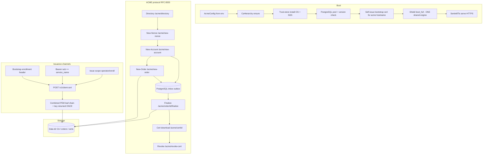

# Design Doc: Sentin8:Acme - Internal ACME Certificate Authority Service

## 1. Summary

Sentin8:Acme is the platform's internal ACME (RFC 8555) certificate
authority. It generates and holds a two-tier CA hierarchy (Root →
Intermediate), issues TLS server certificates for every Sentin8 domain
(including localhost and internal hostnames no public CA can sign),
installs its Root CA into the OS and Chromium/NSS trust stores, and
mints RFC 8705 mTLS client certificates for M2M workloads. For external
domains it proxies orders to a public ACME provider. Mint endpoints are
admission-controlled (ACME-PREF): a saturated storm answers a clear
`503 + Retry-After` instead of silently timing out callers.

## 2. Motivation

- **Post-quantum TLS needs its own authority.** The platform's TLS stack
  (X25519MLKEM768 / ML-DSA-65) is exclusive - no classical fallback -
  so certificates must come from a platform-controlled CA, not a public
  CA whose ecosystem lags the cipher suite requirements.
- **Internal hostnames cannot be publicly signed.** `{service}.{env}.
  {org}.{tld}` domains, `.local` names, and private IPs are unsignable
  by public CAs; the platform needs an authority that trusts them
  everywhere automatically (OS trust store + NSS for Chromium).
- **Certificate-bound M2M identity.** M2M tokens are certificate-bound
  by default (RFC 8705 `cnf`). Every workload needs a client certificate
  at first boot - including the first-boot chicken-and-egg case where
  the workload holds neither a certificate nor a token.
- **One issuer for everything.** Server leafs (HTTPS), client leafs
  (mTLS identity), and the trust anchor all come from one service, one
  CA, one admin surface.
- **Overload must be loud, not lethal.** A fleet-wide cold start makes
  every service re-dial acme at once; an unbounded mint path let callers
  time out silently while its own duties starved - the shed (bounded
  mint queue, `503 + Retry-After`) makes the saturation deterministic
  and self-draining (`DESIGN.md` §6.1).

## 3. Architecture & High-Level Design

- **Boot chain-of-trust.** The acme service signs its own hostname's
  bootstrap certificate at startup with the CA it just loaded - no ACME
  fetch is needed for its own TLS endpoint. Other services then fetch
  their certificates from acme over HTTPS (Sentin8:TLS round-robin).
- **Domain classification.** Orders classify as **local** or **external** by a
  pure, offline rule (never DNS): builtin local forms (`localhost`,
  `*.localhost`, `*.local`, private/loopback IP literals) plus every suffix
  in `SENTIN8_ACME_LOCAL_DOMAINS` (e.g. `local.sentin8.dev,local.ibank.dev`).
  Mixed orders are rejected. Local orders are signed directly by the
  Intermediate CA with HTTP-01 short-circuited (the challenge target is the
  platform's own network); external orders are relayed to the upstream ACME
  provider when proxy mode is enabled - and rejected otherwise (the
  platform CA never signs an unproven public name).
- **Upstream relay is a real RFC 8555 client.** External orders ride an
  ES256 account (key persisted in acme's data dir), JWS-signed requests
  with fresh nonces, a real rcgen CSR at finalize, and HTTP-01 challenge
  tokens served through the proxy's :80 listener
  (`SENTIN8_PROXY_HTTP_PORT`) so the upstream can validate control. The
  upstream certificate chain is cached locally like any other issued cert.
- **Admission channels for client certificates** (each independently
  authenticated):
  1. **Bootstrap enrollment** - the workload presents the
     `X-Sentin8-Bootstrap-Enrollment` secret that captain brokered to
     both the workload and acme at spawn time. Verified locally (no
     auth round-trip - breaks the first-boot chicken-and-egg),
     time-boxed, and scoped to `m2m-*` client certs only.
  2. **Self-issuance** - the caller presents a Sentin8:Auth bearer whose
     `sub` equals the requested `service_name` (a workload re-issuing
     its own identity).
  3. **Enroll/operator** - the bearer carries
     `sentin8:acme:clientcert:issue` (the platform vocabulary scope; the
     enroll path provisions any declared workload's initial certificate).
- **Admin surface** - RFW pages (overview, certificates, settings) plus
  the shared Shield policy-admin API and Policy Studio aliases, all
  Shield-gated.

## 4. Key Traits and Data Structures

- **`AcmeConfig`** - runtime configuration from `SENTIN8_ACME_*` env vars:
  port, data dir, validity periods (root 3650d, intermediate 1825d,
  leaf 90d defaults), trust-store install flag, upstream provider URL,
  database/bus/valkey URLs, and the Auth verification client.
- **`CaHierarchy`** - the loaded-or-generated CA: Root (`rcgen::Certificate`
  + key) and Intermediate (`rcgen::Certificate` + key), plus the on-disk
  PEM bytes of both. The rcgen objects are *reconstructions* used only as
  issuers when signing; the stored PEM bytes carry the real signatures and
  are what gets served or installed.
- **`AppState`** - config, CA hierarchy, issuer base URL, in-memory nonce
  store (`RwLock<HashMap>`), DB pool, Shield engine, and the shared
  Shield policy-admin state.
- **`OrderRecord` / `AuthorizationRecord` / `ChallengeRecord` /
  `AccountRecord`** - the RFC 8555 protocol objects, persisted as JSON
  files in the data directory.
- **`ClientCertRequest`** - `service_name` (must equal the caller's
  token `sub`, self-issuance only) + validity days (default 365,
  clamped 1-3650).

## 5. Rationale, Trade-offs, and Alternatives

- **Two-tier CA (Root + Intermediate).** The Root stays offline-grade
  (10-year validity) while the Intermediate signs leafs, so leaf
  validity policy (90 days) and intermediate rotation never touch the
  trust anchor. A single-tier CA would force re-trusting every browser
  and OS store whenever issuance policy changed.
- **Offline infra mint (`--ensure-infra-tls`).** The same CA that mints
  runtime identity also mints the INFRASTRUCTURE identities offline -
  the Valkey + PostgreSQL TLS server leafs and the fixed plane client
  pairs (valkey control/admin/registry-writer, postgres-ops), plus the
  TLS-only `pg_hba.conf`/`pg_ident.conf` seeds (group DESIGN.md §3.1,
  §3.2). `make infra-tls` runs this mode before `make infra-up`: the
  TLS-only data planes cannot boot without their server leaves, and the
  operator identities must exist before the first enroll.
- **Reconstructed rcgen issuers + stored PEM bytes.** rcgen cannot
  re-sign an existing certificate, so loading reconstructs
  `Certificate` objects for signing - which are self-signed and MUST
  NOT be served. The on-disk PEM bytes are the single source of truth
  for serving; this split is load-bearing (`intermediate_ca_pem()`
  returns the stored bytes, never the reconstruction's output).
- **Bootstrap enrollment channel.** A first-boot workload holds no cert
  and no token - the exact cycle cert-bound M2M would otherwise create.
  Captain brokers the enrollment secret to both the workload and acme at
  spawn; acme verifies the claim against the CURRENT sealed record read
  fresh from disk per request (not the process's stale env copy), so
  mid-boot record regeneration never strands a bearer-less caller. On
  multi-host fleets (FLEET-2, captain DESIGN §11.2) a local-record miss
  falls back to the fleet-published records (`captain:enrollment:{ip}` -
  every captain re-publishes its current sealed record each monitor
  tick, 120s TTL), so a workload spawned on a provisioned machine mints
  against the fleet-singleton acme on the base machine. The channel is
  scoped to `m2m-*` client certs only (never TLS server leafs) and
  logged at warn for audit visibility.
- **Freshness anchored on the record's timestamp, not the caller's.**
  The caller's timestamp is its spawn-time copy; checking it would reject
  first-boot workloads spawned well before acme validates. The secret
  equality is the real possession proof.
- **File-backed ACME objects (orders, authzs, accounts).** ACME state is
  small, local, and operational (not tenant data); the filesystem keeps
  the protocol implementation simple and audit-friendly. A DB-backed
  store would add RLS and connection overhead for no isolation benefit -
  the CA is a system-scope singleton.
- **HTTP-01 only, with local short-circuit.** HTTP-01 works for every
  internal hostname (the challenge target is the platform's own
  network); DNS-01 would require zone control acme doesn't have.
  Local-domain short-circuit avoids a pointless self-fetch during
  issuance.
- **Combined cert+key download.** Locally-issued certificates are served
  as one PEM artifact (chain + key) because the TLS layer builds its
  `ServerConfig` from both; upstream certificates return cert-only (the
  key never leaves the requester).
- **Combined PEM returned once for client certs.** The private key is
  never persisted server-side - the caller persists it in its own
  credential cache. The certificate (without key) is recorded so the
  admin UI can list and revoke it.
- **Shared Shield engine, constructed once.** The boot path loads ONE
  policy engine and `AppState` shares the same `Arc`; a second engine
  would hold an empty cache and deny fail-closed on every admin request.
  The enforced scope-mirror policy set over LIVE effective scopes is the
  only gate for admin UI paths.
- **Rejected: per-service self-hosted CAs.** Every service would need
  its own trust anchor distribution, rotation, and revocation story;
  centralized issuance keeps one root, one fingerprint, one revocation
  surface.

## 6. Internal Implementation & Invariants (Private Design)

- **Invariants:**
  - The Intermediate CA MUST always be served from the stored PEM bytes
    (signed by Root); the rcgen reconstruction would break every
    client-side chain verification.
  - The bootstrap-enrollment channel may mint ONLY client certificates
    (`m2m-*` CN prefix) - never TLS server leafs; the CN prefix is the
    scope boundary.
  - `service_name` must match `^[A-Za-z0-9_:-]+$` and equal the bearer's
    `sub` unless the caller carries the issuance scope.
  - Nonces are single-use, in-memory, time-stamped (RFC 8555 §6.5
    replay protection); the store is per-process (acceptable because
    ACME clients re-fetch nonces per request to the same replica).
  - Order authorization is single-identifier (the first identifier
    drives the authz/challenge pair); finalize extracts all DNS
    identifiers into the SAN list.
  - Client-cert keys are never persisted server-side; only the
    certificate + metadata (domain, kind `client`, expiry, revoked) are.
  - Events (`sentin8:acme:account:created`, `order:created`,
    `order:finalized`, `clientcert:issued`, `certificate:revoked`) go
    through the LOCAL outbox path - the service's own `acme.outbox`
    table (same-transaction system-env context, then the post-commit
    relay pushes to Bus's produce API with the `sentin8:acme`
    producer M2M workload; no cross-schema grants),
    `DESIGN.md` §3.
  - Mint endpoints share ONE bounded admission queue - when the queue
    is full, the acme answers `503 Service Busy` + `Retry-After: 30`
    (the fetcher's backoff window) instead of accepting work it cannot
    complete before the caller's request timeout. Health, CA downloads,
    and cert downloads are never shed.
- **Trust-store installation is best-effort.** OS store + NSS
  (certdb/NSS profile scan) both warn-and-continue on failure - browsers
  keep working via the served intermediate; the intermediate is also
  installed into NSS because some Chromium versions don't use the
  handshake intermediate for trust-building.
- **Bounded inventory.** The admin certificates listing returns the
  newest 500 entries (mtime-descending) - the directory is append-only
  and would otherwise ship megabytes and stall the RFW DataTable. Older
  certificates stay revocable by id.
- **Boot order matters.** CA → trust store → DB pool + version check →
  bootstrap cert → Shield boot_full → TLS serve. PostgreSQL 18+ is
  enforced; the DCR-registered OAuth database client is detected and
  logged.

## 7. Unresolved Questions / Future Designs

- Revocation marks metadata and announces the event; the event
  (`sentin8:acme:certificate:revoked`) already carries revocation visibility
  to consumers.
- ACME account key-pair verification (JWS-signed requests per RFC 8555)
  verifies the JWS embedded key thumbprint against the account's stored public
  key.
- Upstream (public ACME) mode is scoped to `dns-01` only (the platform owns
  the managed zone's TXT records); the challenge relay stays a skeleton.
- Certificate auto-renewal delegates per certificate via the cron design's
  registration pattern.

---

**Design attribution:** sentin8:acme and its underlying concepts were designed by Hamid Jahanzad <Hamid@Jahanzad.com>.
